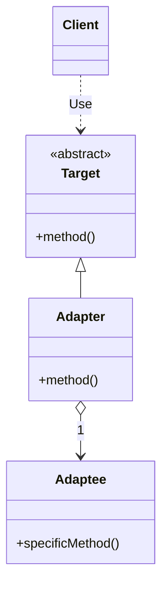
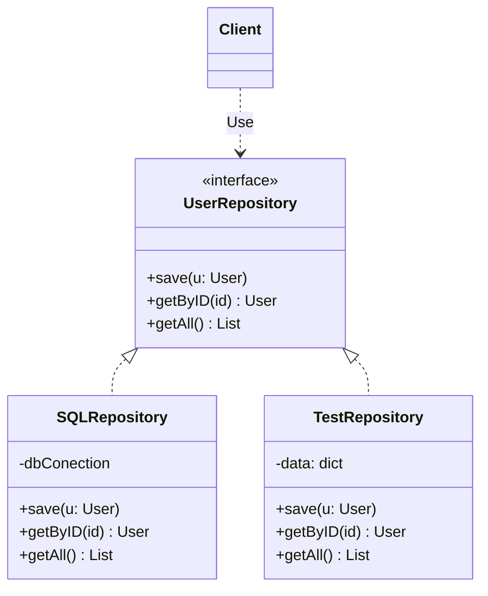
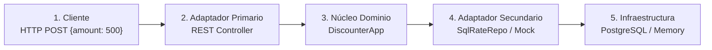

# Arquitectura Hexagonal

---

## Limitaciones de la Arquitectura N-Tier

- **Esquema unidimensional:** Presentación -> Negocio -> Persistencia/BD.
- **Fuga de abstracción:** Las entidades de dominio tienden a terminar decoradas con anotaciones de base de datos (`@Entity`, `@Table`, `@Column`) y tipos SQL.
- **Dependencia transitiva:** El negocio depende conceptualmente de la base de datos subyacente.
- **Costo de cambio elevado:** Un cambio en las reglas de negocio propaga cambios técnicos en la UI y en la estructura de tablas.
- **Dificultad para pruebas aisladas:** Ejecutar pruebas unitarias del negocio requiere con frecuencia levantar bases de datos relacionales completas.

---

## Paradigma Hexagonal (I)

### Núcleo Interior

- **Soberanía del Dominio:** Contiene únicamente las reglas de negocio puras, entidades y casos de uso.
- **Agnosticismo Tecnológico:** No contiene dependencias de *frameworks* web, *drivers* de bases de datos, librerías UI ni protocolos de red.
- **Regla:** El código del interior nunca debe depender del exterior ni filtrar sus detalles técnicos.
- **Lenguaje Ubicuo:** Refleja el problema del negocio, no los requerimientos técnicos de la infraestructura.

### Exterior Simétrico

- **Tratamiento simétrico:** Para el núcleo, un usuario en un navegador, un *script batch* y una prueba unitaria son conceptualmente idénticos.
- **Dispositivos periféricos:** Bases de datos, colas de mensajería, APIs de terceros y pantallas gráficas pertenecen todos al exterior.
- **Puertos como fronteras:** El interior se comunica con el exterior exclusivamente a través de puertos funcionales.
- **Intercambiabilidad total:** Cambiar entre motores de bases de datos o entre tecnologías de intercambio de información no alterará el dominio interior.

---

## Paradigma Hexagonal (II)

- **Núcleo (Inside):** Contiene la lógica de negocio pura (entidades y casos de uso). No conoce *frameworks*, bases de datos ni protocolos de comunicación.
- **Puertos (Ports):** Son la frontera del hexágono. Son contratos o interfaces puras (APIs) definidas exclusivamente en función del propósito del negocio, no de la tecnología.
- **Adaptadores (Adapters):** Son traductores tecnológicos que convierten las señales del entorno externo a llamadas que el dominio entiende, y viceversa.

> **La arquitectura hexagonal, expresada de una forma simple, consiste en aislar el núcleo de negocio en el interior y rodearlo de puertos (contratos) y adaptadores (traductores de tecnología).**

**Diagrama (descripción):** Un hexágono central, "Núcleo de Dominio (Core Application)", que contiene casos de uso, entidades de negocio y reglas invariantes.

| Lado | Tipo | Elementos |
|---|---|---|
| Izquierdo | **Adaptadores primarios (Driving)** — inician la acción, sacan la app de reposo | REST Controller / HTTP (cliente web/móvil) y Test Harness (JUnit / FIT) → *Puerto primario 1*; CLI / Consola Batch (scripts de terminal) → *Puerto primario 2* |
| Derecho | **Adaptadores secundarios (Driven)** — invocados por la app (persistencia / I/O) | *Puerto secundario 1* → Base de datos SQL / JPA (PostgreSQL / Oracle) y Mock In-Memory DB (para pruebas aisladas); *Puerto secundario 2* → Message Broker / API externa (Kafka / RabbitMQ / Stripe) |

---

## Diagrama de ejemplo: Hexagonal Architecture + Clean Architecture Layers

*(Diagrama de Valentina Cupać, journal.optivem.com)*

**Leyenda del diagrama:**

- **Application** (hexágono): núcleo de la aplicación.
- **Ports** (interfaces): puertos.
- **Adapters:** cuadros grises en el exterior.
- **Use Case Layer** (Clean Architecture): implementaciones de casos de uso.
- **Domain Layer** (Clean Architecture): entidades (Customer, Order, Product).
- **Relaciones:** flecha punteada = *USES*; flecha sólida = *IMPLEMENTS*.

**Elementos representados:**

| Puerto (interfaz) | Implementación en el núcleo | Entidades que usa |
|---|---|---|
| Submit Order Use Case Interface | Submit Order Use Case Implementation | Customer, Order, Product |
| Cancel Order Use Case Interface | Cancel Order Use Case Implementation | Order |
| Get Order Details Use Case Interface | Get Order Use Case Implementation | Order |
| Sync Product Pricing Use Case Interface | Sync Product Pricing Use Case Implementation | Product |

Puertos secundarios usados por los casos de uso: Order Repository Interface, Order ID Generator Interface, Time Provider Interface, Product Repository Interface y Product Gateway Interface, cada uno con adaptadores externos que lo implementan.

---

## La Frontera de Persistencia

- **Principio de Inversión de Dependencias:** Módulos de alto nivel no deben depender de módulos de bajo nivel; ambos deben depender de abstracciones.
- **Inversión de flechas:** El flujo de ejecución va hacia la BD, pero la dependencia de código se invierte hacia el Dominio.
- **Inyección de dependencias (DI):** En tiempo de ejecución se inyecta el adaptador concreto mediante constructores.

**Diagrama (descripción):**

- *Núcleo del Dominio (Lógica de Negocio):* `DiscounterApp` (clase de dominio, método `calculateDiscount(amt)`) **usa** la interfaz `«interface» RateRepository` (método `getRate(amt)`).
- *Infraestructura (Adaptadores):* `SqlRateRepository (Prod)` — consulta JDBC / JPA en Postgres — y `MockRateRepository (Test)` — lógica en memoria, ultra-rápido — ambos **implementan** `RateRepository`.
- *Principio DIP:* el flujo de control va a la BD, pero la dependencia de código se invierte hacia el Dominio. El Dominio define la interfaz; la infraestructura externa depende del contrato del Dominio.

---

## Patrón Adapter (I)

Adapter es un patrón de diseño estructural que permite que dos objetos con interfaces incompatibles puedan colaborar y trabajar juntos.

Funciona de forma similar a un adaptador físico de enchufe. Cuando viajas a un país con tomas de corriente diferentes, no cambias el cable de tu computador; en lugar de eso, colocas un adaptador intermedio que sirve como puente para la conexión.

Imagina que tienes un sistema que procesa datos exclusivamente en formato JSON y quieres integrar una librería externa o un servicio de terceros para analizar esos datos, pero esa librería solo acepta datos en formato XML o utiliza un nombre de métodos distinto.

No puedes modificar la librería externa porque no tienes acceso a su código fuente o romperías otros sistemas, y tampoco quieres reescribir todo tu sistema para cambiar JSON por XML.

---

## Patrón Adapter (II)

El patrón propone crear una clase Adaptador que envuelve la clase incompatible (llamada *Adaptee*).

El adaptador implementa la interfaz que el cliente espera recibir, intercepta las llamadas, traduce los datos (o la llamada a los métodos) al formato que requiere la clase de terceros y le delega el trabajo real.

**Diagrama UML (descripción):**

---

## Rol del Patrón Adapter

- En la arquitectura hexagonal, un adaptador traduce señales técnicas externas a llamadas de métodos del puerto.
- Si una API de terceros o un *framework* web actualiza su versión o protocolo, solo se modifica el adaptador.
- El adaptador evita que formatos externos (JSON, XML, `ResultSet` de SQL) penetren en el código de negocio.
- **Adaptadores Primarios (Driving / Inbound):** Convierten peticiones HTTP, eventos o entradas de consola en comandos de dominio.
  - *Ejemplo:* Un Controlador REST extrae JSON, valida tipos y llama al servicio respectivo del Dominio.
- **Adaptadores Secundarios (Driven / Outbound):** Convierten peticiones del dominio a llamadas de infraestructura.
  - *Ejemplo:* Un adaptador Hibernate traduce objetos del dominio a consultas SQL y mapea resultados.

---

## Patrón Repository (I)

Repository es un patrón de arquitectura y persistencia que actúa como una capa de abstracción entre la capa de dominio (lógica de negocio) y la capa de acceso a datos (bases de datos SQL, NoSQL, APIs externas, memoria, etc.).

Su objetivo es encapsular la lógica requerida para acceder a los datos, permitiendo que la aplicación trate a la base de datos como si fuera una colección en memoria de objetos de dominio.

Si la lógica de negocio realiza consultas SQL directamente, interactúa con ORMs o hace peticiones HTTP a bases de datos, se presentarán problemas por:

- **Alto acoplamiento:** Si decides cambiar el motor de bases de datos o reemplazas el ORM, tendrás que modificar el código de tu aplicación donde existan consultas.
- **Dificultad para pruebas unitarias:** No puedes probar la lógica de negocio de forma rápida o aislada porque el código siempre intentará conectarse a una base de datos real.

---

## Patrón Repository (II)

El patrón propone definir una interfaz abstracta que declara las operaciones CRUD y de búsqueda orientadas a objetos de dominio (guardar, obtener_por_id, eliminar, etc.).

Luego se crea una o varias implementaciones concretas (ej. RepositorioUsuarioSQL, RepositorioUsuarioMemoria). La lógica de negocio solo depende de la interfaz abstracta, desconociendo completamente dónde o cómo se guardan los datos.

**Diagrama UML (descripción):**

---

## Rol del Patrón Repository

- Su función es la de mediar entre el dominio y las capas de mapeo de datos, actuando como una colección de objetos en memoria.
- La interfaz es un **puerto secundario** que se aloja dentro del núcleo.
- La implementación concreta es un **adaptador secundario** que vive en la infraestructura.
- El Núcleo o Dominio no sabe de tecnologías de persistencia.
- **Sustitución inmediata:** Para pruebas unitarias, se puede inyectar un repositorio en memoria, sin configurar bases de datos.

---

## Dirección de las Comunicaciones

### Puertos Primarios o Conducentes (Driving Ports)

- Los actores externos sacan a la aplicación de su estado de reposo por medio de puertos primarios.
- **Ubicación convencional:** Lado izquierdo o superior del hexágono.

**Ejemplos de adaptadores conectados:**

- Controladores REST / gRPC.
- Comandos de consola (CLI).
- Arneses de pruebas automatizadas (JUnit).
- Colas de mensajes (RabbitMQ).

### Puertos Secundarios o Conducidos (Driven)

- La aplicación invoca a un actor externo para persistir o consultar datos por medio de puertos secundarios.
- **Ubicación convencional:** Lado derecho o inferior del hexágono.

**Ejemplos de adaptadores conectados:**

- Adaptador SQL, JPA o Hibernate hacia PostgreSQL.
- Adaptador *mock* en memoria para pruebas.
- Adaptador HTTP Client hacia pasarela Stripe o PayPal.
- Publicador de eventos hacia Apache Kafka.

---

## La Frontera del Hexágono

### El Error Tradicional

- **Casos de uso acoplados a la UI** — Ejemplo: El usuario hace clic en el botón "guardar" y el sistema guarda en la tabla ORDERS.

**Consecuencias de este diseño:**

- Especificaciones rígidas, frágiles y costosas de mantener.
- Imposible reutilizar la lógica para llamadas por API o procesos por lotes.

### Solución Hexagonal

- **Casos de uso sobre el Puerto** — Ejemplo: El sistema calcula el descuento dado un monto válido.

**Intención del negocio:**

- Agnóstico con respecto al origen del monto. Este puede venir de un formulario web, un JSON o un archivo CSV.
- Define precondiciones, reglas de negocio y postcondiciones.

### Ventajas

- **Especificaciones ejecutables:** Cada caso de uso puede ser validado directamente con un test automatizado.
- **Longevidad de la solución:** La lógica puede sobrevivir a rediseños de UI y migraciones de nube.
- **Desarrollo paralelo:** Los equipos de *backend* y *frontend* pueden trabajar contra contratos sin bloquearse.

---

## Mapeo de una Interacción

**Flujo de ejecución de extremo a extremo (cálculo de descuento):**

| Paso | Componente | Detalle |
|---|---|---|
| 1 | **Cliente** | HTTP POST `{amount: 500}` |
| 2 | **Adaptador Primario** | REST Controller (valida y parsea) |
| 3 | **Núcleo Dominio** | `DiscounterApp` (regla: `amt * rate`) |
| 4 | **Adaptador Secundario** | `SqlRateRepo` / Mock (obtiene `rate`) |
| 5 | **Infraestructura** | PostgreSQL / Memory (almacenamiento) |

> **Nótese:** El núcleo de dominio (paso 3) solo conoce la interfaz `RateRepository`. Nunca interactúa directamente con SQL ni HTTP.

---

## Cuándo Adoptar la Arquitectura Hexagonal

### Aplicar cuando:

- El dominio tiene reglas cambiantes o alta complejidad.
- Se requiere alta velocidad de pruebas de regresión automatizadas sin infraestructura.
- El sistema ofrece múltiples canales de entrada (REST, CLI, eventos) o almacenamiento diverso.
- Proyectos con expectativa de vida media o larga y evolución tecnológica continua.

### NO aplicar / Trade-offs:

- Sistemas CRUD simples donde el negocio es un simple intermediario hacia la base de datos.
- Prototipos rápidos donde el costo de abstracción supera el beneficio.
- **Sobrecarga de clases:** Requiere más interfaces, mapeos de DTOs y configuración inicial.

---

## Principios Fundamentales

- **El Dominio es el Soberano:** El núcleo de negocio jamás debe conocer detalles de bases de datos, protocolos de red ni *frameworks*.
- **Los Puertos son Contratos Funcionales:** Diseña las interfaces pensando en el propósito del negocio, no en la tecnología que las implementará.
