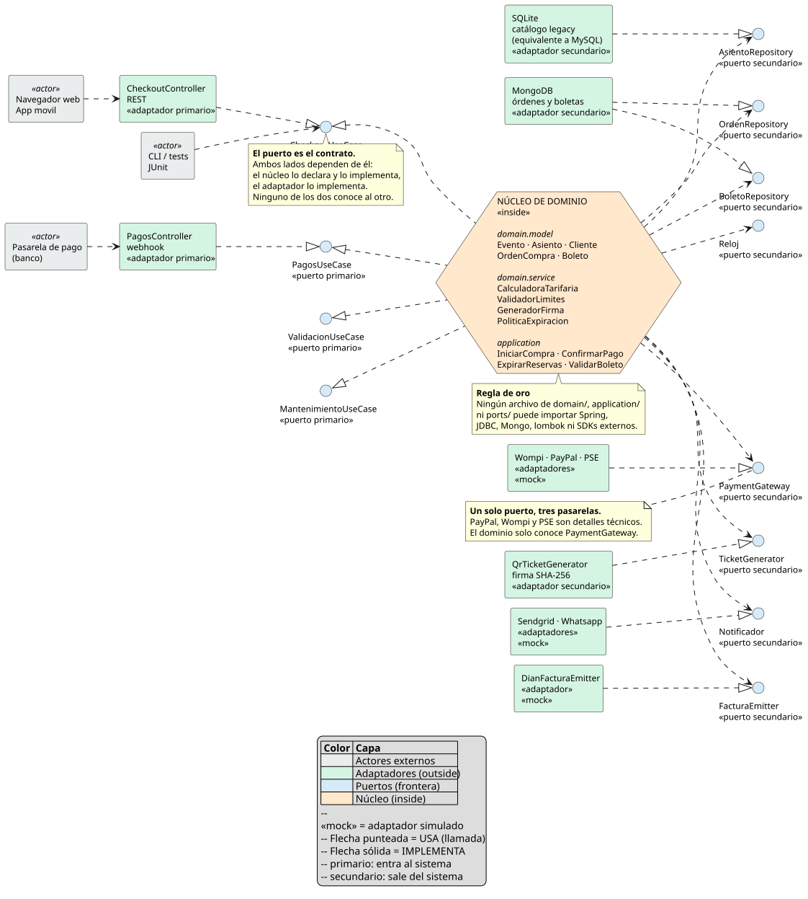
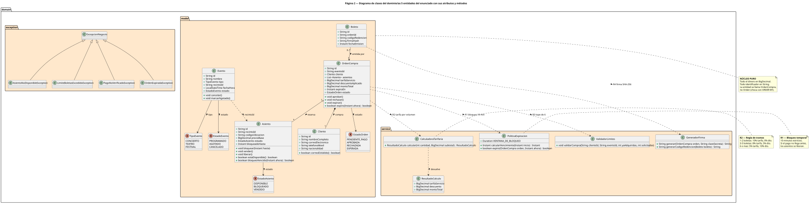
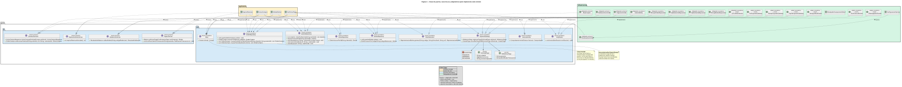

# Diagramas del Sistema — StagePass Live

Directorio central de diagramas arquitectónicos y de dominio del taller de **Arquitectura Hexagonal**.

## 📑 Índice de Diagramas

| Diagrama | Descripción | SVG Vectorial | Imagen PNG | Código PlantUML |
|---|---|---|---|---|
| **Arquitectura Hexagonal** | Capas, puertos primarios/secundarios y adaptadores | [arquitectura.svg](svg/arquitectura.svg) | [arquitectura.png](png/arquitectura.png) | [diagrama-arquitectura.puml](puml/diagrama-arquitectura.puml) |
| **Modelo de Dominio** | Entidades, Value Objects, Servicios y Reglas puras | [dominio.svg](svg/dominio.svg) | [dominio.png](png/dominio.png) | [diagrama-dominio.puml](puml/diagrama-dominio.puml) |
| **Contratos e Interacción** | Secuencia y llamadas entre puertos | [contratos.svg](svg/contratos.svg) | [contratos.png](png/contratos.png) | [diagrama-contratos.puml](puml/diagrama-contratos.puml) |

---

## 1. Arquitectura Hexagonal Global

---

## 2. Modelo de Dominio

---

## 3. Contratos y Flujo de Interacción

